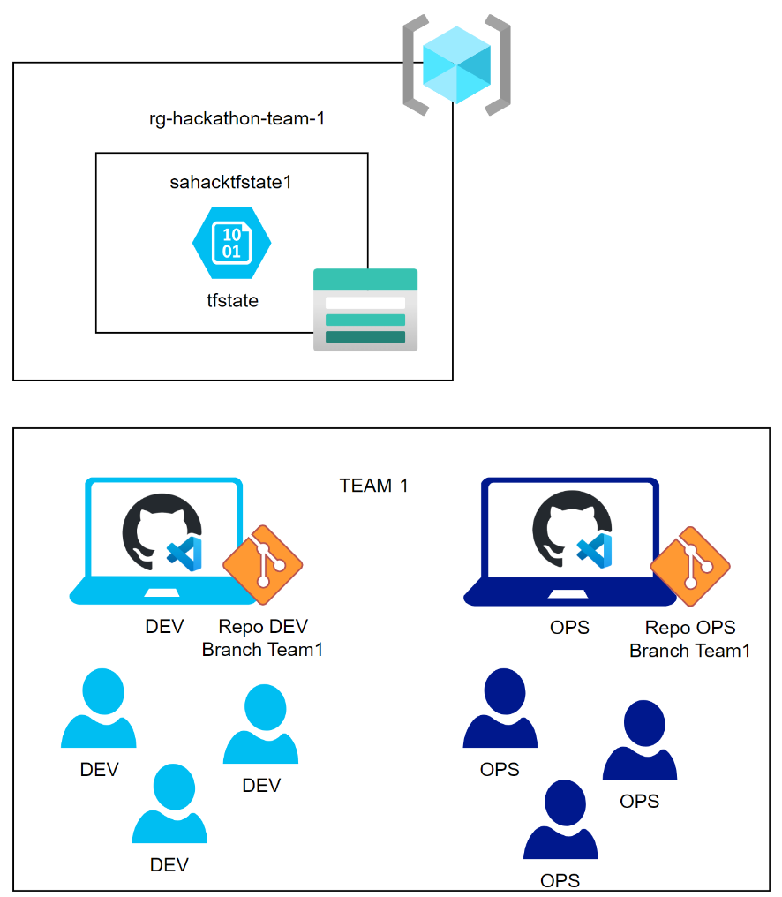

# GitHub Hackathon - Organizer Instructions

## Challenges and objective 🎯
The challenge is to develop a software described in the "Challenge" section using the most modern development tools: GitHub Repos for code and GitHub Actions for automation, GitHub Codespaces as development environment and obtaining assistance from GitHub Copilot.

## Hackathon execution 📃
The partecipants will be divided in N groups. Each group must have members with developer skills for the application challlenges and operation skills for the infrastructure challenges. Other roles can partecipate as well in order to contribute other challenges. Each team will be identified as:
<table>
 <tr><th>Team</th><th>Subteam</th><th>Partecipants</th></tr>
 <tr><td>Team1</td><td>devTeam1</td><td>(fill with partecipant list)</td></tr>
 <tr><td> </td><td>opsTeam1</td><td>(fill with partecipant list)</td></tr>
 <tr><td>Team2</td><td>devTeam2</td><td>(fill with partecipant list)</td></tr>
 <tr><td> </td><td>opsTeam2</td><td>(fill with partecipant list)</td></tr>
 <tr><td>Team3</td><td>devTeam3</td><td>(fill with partecipant list)</td></tr>
 <tr><td> </td><td>opsTeam3</td><td>(fill with partecipant list)</td></tr>
</table>
Subteams part of the same Team will work togheter (in the same room) in order to sync and achieve the final result: the working system must be deployed.

At least 1 computer is required for each subteam. The different members part of it can work in collaboration alternating each other.

## Environment set-up steps ⚙️
1) Fork the repositories that will contain the assets to execute the hackathon. Use a name that make sense for the event. Use a suffix to differentiate the fact the one is for the developers and the other for he operations (i.e. gh-hackathon-dev and gh-hackathon-ops). 
	- Dev Repo: [gh-hackathon-dev](https://github.com/Frank802/gh-hackathon-dev)
	- Ops Repo: [gh-hackathon-ops](https://github.com/Frank802/gh-hackathon-ops)

   Make sure the forked repo name for the "Dev Repo" reflects the path portion on the line #36 of the file .devcontainer/devcontainer.json within the repo or adeguate it.
2) For each repo, create N branches for each team that will partecipate to the hackathon. In this way, each group wil work on its own "workspace". Name it "team1, team2, team3, etc."
3) Create N resource groups in Azure for each team that will partecipate to the hackathon. Name the resource group: "rg-hackathon-team-1","rg-hackathon-team-N"
4) In each resource group create a storage account to be used for the Terraform state. Name this storage account: "sahacktfstateN" (replace N with the team number). Create within it a container named "tfstate".
5) Create in Azure a service principal (app registration) with a secret. This service principal must have a contributor role on each resource group. This principal will be used within GitHub to deploy the Azure infrastracture and the application.  
OPTIONAL: You can add the contributor role to each team partecipant as well in order to let them to review the outcome of the CI/CD pipelines by using the Azure Portal.
6) For the "gh-hackathon-ops" repo, configure the following Codespaces secrets:
	<table>
	<tr><th>Secret Name</th><th>Description</th></tr>
	<tr><td>ARM_CLIENT_ID</td><td>Client ID of the app registration</td></tr>
	<tr><td>ARM_CLIENT_SECRET</td><td>Secret of the app registration</td></tr>
	<tr><td>ARM_TENANT_ID</td><td>Microsoft Entra Tenant ID</td></tr>
	<tr><td>ARM_SUBSCRIPTION_ID</td><td>The ID of the Azure subscription</td></tr>
	</table>

	Those variables will allow the operation team to preview the terraform changes whitin the codespace.

7) For both the "gh-hackathon-ops" and "gh-hackathon-dev" repos configure the following Actions secret:
	<table>
	<tr><th>Secret Name</th><th>Description</th></tr>
	<tr><td>AZURE_CREDENTIALS</td><td>{"clientId": "GUID","clientSecret": "GUID","subscriptionId": "GUID","tenantId": "GUID"}</td></tr>
	<tr><td>ARM_CLIENT_ID</td><td>Client ID of the app registration</td></tr>
	<tr><td>ARM_CLIENT_SECRET</td><td>Secret of the app registration</td></tr>
	<tr><td>ARM_TENANT_ID</td><td>Microsoft Entra Tenant ID</td></tr>
	<tr><td>ARM_SUBSCRIPTION_ID</td><td>The ID of the Azure subscription</td></tr>
	</table>

 ## Execution 💻
 
 
 ## Solutions ✅
 The folder [solutions](solutions) will contain asset of an already executed hackathon useful to have a reference for help the teams during their hackathon.
